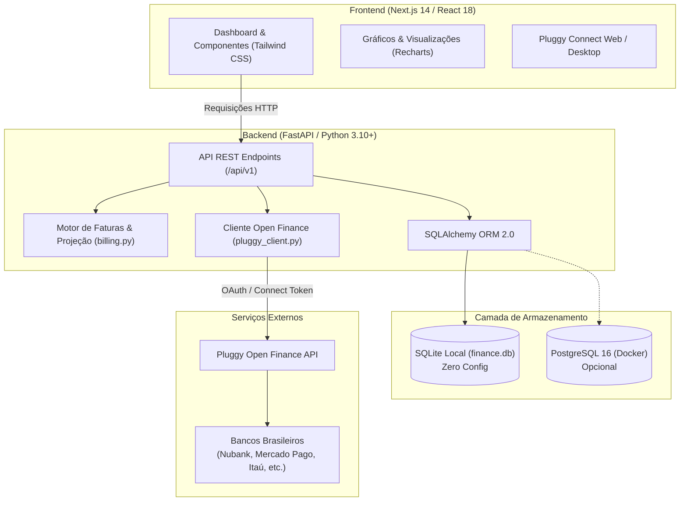

# 💼 Nexo — Gerenciador de Finanças Pessoais

<div align="center">


<p align="center">
  <b>Sistema moderno de inteligência financeira pessoal e fluxo de caixa preditivo com integração direta ao Open Finance Brasil.</b>
</p>

[Visão Geral](#-visão-geral) •
[Funcionalidades](#-funcionalidades-em-destaque) •
[Arquitetura](#-arquitetura-do-sistema) •
[Como Executar](#-como-executar-o-projeto) •
[Conexão Bancária](#-como-conectar-seu-banco-open-finance) •
[Executável Windows](#-como-gerar-o-executável-para-windows-exe) •
[API REST](#-documentação-da-api-rest) •
[Testes](#-testes-automatizados)

</div>

---

## 📌 Visão Geral

O **Nexo** é um gerenciador de finanças pessoais local-first projetado com design minimalista de alta performance (inspirado nos padrões visuais do Linear e Mercury). 

A maioria dos aplicativos bancários mostra apenas o seu **saldo nominal presente** — uma métrica enganosa, pois desconsidera faturas abertas de cartão de crédito, compras parceladas e contas fixas que ainda vão vencer antes do próximo salário.

O diferencial do Nexo é o **Raio-X do Salário (Fluxo de Caixa Antecipado)**: um motor de projeção financeira em tempo real que deduz todos os seus compromissos futuros até a data do próximo recebimento, entregando a única métrica que realmente importa: **o seu Saldo Livre Real e o seu limite de gastos diários seguros**.

Tudo isso sincronizado automaticamente com suas contas bancárias reais (Nubank, Mercado Pago, Itaú, Bradesco, Inter, Santander, C6, etc.) através do ecossistema oficial do **Open Finance Brasil** via **Pluggy API**.

---

## ✨ Funcionalidades em Destaque

### 📊 1. Raio-X do Salário & Fluxo de Caixa Antecipado
- **Cálculo Matemático em Tempo Real:**
  $$\text{Saldo Livre Real} = (\text{Salário Previsto} + \text{Saldo Bancário} + \text{Caixinhas CDI}) - \text{Fatura Atual do Cartão} - \text{Contas Fixas Pendentes}$$
- **Orçamento de Sobrevivência Diário:** Mostra exatamente quanto você pode gastar por dia ($R\$ / \text{dia}$) até o fechamento do seu ciclo salarial sem entrar no vermelho.
- **Contador de Dias Restantes:** Exibe o número de dias até o próximo pagamento e alerta sobre a taxa de comprometimento da renda.

### 🏦 2. Open Finance Brasil Nativo (Pluggy API)
- Conexão oficial e homologada com bancos brasileiros através do conector seguro Pluggy Connect embutido (`/connect`).
- Sincronização automática de contas correntes, poupanças e contas de pagamento.
- Leitura automatizada de transações com categorização automática, identificação de estabelecimentos e conciliação de saldos.

### 💳 3. Gestão Avançada de Cartões de Crédito & Faturas
- **Ciclo Dinâmico de Faturas:** Separação precisa entre fatura atual (aberta), faturas fechadas com vencimento próximo e parcelas futuras.
- **Auto-Healing de Transações:** Atribuição e conciliação inteligente de compras em trânsito com matching de ciclo e datas de fechamento.
- **Configuração de Fechamento/Vencimento:** Personalização das datas de corte de cada instituição bancária.

### 🐷 4. Caixinhas & Reservas de Rendimento (Mercado Pago / CDI)
- **Rendimento CDI (Saldo Livre):** Marque reservas de liquidez diária para compor o saldo disponível para despesas no Raio-X.
- **Proteção de Metas:** Caixinhas vinculadas a metas de poupança são blindadas contra gastos correntes no mês.
- **Ajuste Manual de Saldo:** Possibilidade de calibrar o valor real caso o banco reporte históricos truncados.

### 🎯 5. Simulador de Compras "Cabe no meu bolso?"
- Simule compras à vista ou parceladas antes de passar o cartão.
- Visualize instantaneamente o impacto da nova despesa no seu saldo livre restante e o novo limite diário seguro.

### 📌 6. Contas Fixas & Recorrentes
- Cadastro de compromissos regulares (aluguel, água, energia, internet, planos de saúde, mensalidades).
- Checkbox interativo com atualização em tempo real para marcar despesas quitadas dentro do ciclo.

### 📈 7. Extrato Inteligente & Análise de Gastos
- **Gráfico Donut Interativo (Recharts):** Distribuição percentual e absoluta de gastos por categorias.
- **Switch iOS de Exclusão:** Ignore transferências entre contas próprias ou aportes em reservas para não inflar artificialmente o cálculo de despesas.
- **Busca & Filtros:** Localização rápida por descrição, categoria ou intervalo de datas.
- **Exportação CSV:** Exporte seu extrato financeiro filtrado com um clique.

### 🎯 8. Metas de Economia
- Crie metas de curto, médio e longo prazo com barra de progresso visual, estimativa de conclusão e aporte integrado com caixinhas.

---

## 🏗️ Arquitetura do Sistema



---

## 📁 Estrutura de Diretórios

```text
gerenciador-de-financas/
├── .github/
│   └── workflows/
│       └── build-exe.yml          # Pipeline CI/CD GitHub Actions para compilar .exe Windows
├── backend/
│   ├── app/
│   │   ├── services/
│   │   │   ├── billing.py         # Motor de cálculo de faturas, ciclos e projeção de faturas
│   │   │   └── pluggy_client.py   # Integração com API Open Finance Pluggy
│   │   ├── database.py            # Sessão do SQLAlchemy e inicialização do banco
│   │   ├── main.py                # Endpoints FastAPI, regras de negócio e rotas estáticas
│   │   ├── models.py              # Modelos do banco de dados (SQLAlchemy)
│   │   └── schemas.py             # Validação e serialização de dados (Pydantic v2)
│   ├── tests/
│   │   ├── test_billing.py        # Testes unitários do motor de faturas e ciclos
│   │   └── test_pluggy_sync.py    # Testes unitários de sincronização e conciliação
│   ├── Dockerfile                 # Contêiner Docker para o backend
│   ├── requirements.txt           # Dependências Python para Linux/Docker
│   └── requirements-windows.txt   # Dependências Python para Windows e compilação desktop
├── frontend/
│   ├── src/
│   │   ├── app/
│   │   │   ├── globals.css        # Estilos globais e temas Tailwind
│   │   │   ├── layout.tsx         # Layout base da aplicação Next.js
│   │   │   └── page.tsx           # Painel principal interativo do Nexo
│   │   ├── components/            # Componentes reutilizáveis de interface
│   │   └── lib/                   # Utilitários de formatação de moeda e datas
│   ├── package.json               # Dependências do frontend (React, Next.js, Recharts)
│   ├── tailwind.config.ts         # Configuração de design system do Tailwind CSS
│   └── tsconfig.json              # Configurações do compilador TypeScript
├── .env.example                   # Modelo de variáveis de ambiente
├── .gitignore                     # Arquivos ignorados pelo controle de versão
├── build_windows_exe.bat          # Script de compilação do executável autônomo Windows
├── conectar_banco.sh              # Utilitário Unix para abrir o conector Open Finance
├── docker-compose.yml             # Orquestração de contêineres Backend + PostgreSQL
├── GerenciadorFinancas.spec       # Especificação do empacotador PyInstaller
├── run_desktop.py                 # Ponto de entrada do aplicativo Desktop (FastAPI + pywebview)
├── start.sh                       # Script de inicialização rápida em Linux / macOS
└── start_windows.bat              # Script de inicialização rápida no Windows
```

---

## ⚙️ Variáveis de Ambiente (`.env`)

Copie o arquivo de exemplo para iniciar suas configurações:

```bash
cp .env.example .env
```

| Variável | Obrigatória | Descrição | Padrão |
| :--- | :---: | :--- | :--- |
| `PLUGGY_CLIENT_ID` | **Sim** | Client ID obtido no [Dashboard da Pluggy](https://dashboard.pluggy.ai/) | — |
| `PLUGGY_CLIENT_SECRET` | **Sim** | Client Secret obtido no [Dashboard da Pluggy](https://dashboard.pluggy.ai/) | — |
| `PLUGGY_ITEM_ID` | Não | ID da conexão bancária (preenchido automaticamente via `/connect`) | *Vazio* |
| `PLUGGY_ACCOUNT_IDS` | Não | Filtro opcional de IDs de contas específicas | *Vazio* |
| `DATABASE_URL` | Não | String de conexão com o banco. Omitir para usar SQLite local | `sqlite:///backend/finance.db` |
| `NEXT_PUBLIC_API_URL` | Não | URL base consumida pelo frontend | `http://localhost:8000/api/v1` |

---

## 🚀 Como Executar o Projeto

### Pré-requisitos
- **Node.js** 18+ e **npm**
- **Python** 3.10+ (ou Docker instalado)

---

### Opção 1: Inicialização em 1 Clique (Windows)

Dê um duplo clique em `start_windows.bat` ou execute no PowerShell/CMD:

```bat
start_windows.bat
```

> **O que este script faz:**
> 1. Detecta Python e Node.js (auxilia na instalação automática caso faltem).
> 2. Cria o ambiente virtual (`backend\.venv`) e instala os requisitos.
> 3. Instala as dependências do frontend via `npm install`.
> 4. Inicia o backend FastAPI em `http://localhost:8000`.
> 5. Inicia o frontend Next.js em `http://localhost:3000`.

---

### Opção 2: Inicialização em 1 Clique (Linux / macOS)

Conceda permissão de execução e inicie o script:

```bash
chmod +x start.sh
./start.sh
```

---

### Opção 3: Execução via Docker Compose

Caso prefira executar todo o backend com banco de dados **PostgreSQL** em contêineres isolados:

```bash
docker compose up -d
```

Para rodar a interface:
```bash
cd frontend
npm install
npm run dev
```

---

### Opção 4: Inicialização Manual (Passo a Passo)

#### 1. Backend (FastAPI):
```bash
# Entre na pasta do backend
cd backend

# Crie e ative o ambiente virtual
python -m venv .venv

# No Windows:
.venv\Scripts\activate
# No Linux/macOS:
source .venv/bin/activate

# Instale as dependências
pip install -r requirements.txt

# Inicie o servidor
uvicorn app.main:app --reload --host 0.0.0.0 --port 8000
```

#### 2. Frontend (Next.js):
```bash
# Em outro terminal, entre na pasta do frontend
cd frontend

# Instale os pacotes
npm install

# Inicie em modo de desenvolvimento
npm run dev
```

Acesse o painel em **[http://localhost:3000](http://localhost:3000)**.

---

## 🔌 Como Conectar seu Banco (Open Finance)

1. Crie uma conta de desenvolvedor gratuita em **[dashboard.pluggy.ai](https://dashboard.pluggy.ai/)**.
2. Na aba **Credenciais / API Keys**, copie o **Client ID** e o **Client Secret** e cole no seu `.env`.
3. Com o sistema rodando, acesse a página de conexão oficial:
   👉 **[http://localhost:8000/connect](http://localhost:8000/connect)**
4. Selecione seu banco (Nubank, Mercado Pago, Itaú, Bradesco, Inter, Santander, etc.) e faça a autenticação segura do Open Finance.
5. Ao concluir, o vínculo bancário será registrado e salvo automaticamente no seu banco de dados local.
6. Volte ao painel principal em **[http://localhost:3000](http://localhost:3000)** e clique em **"Sincronizar"** para carregar contas, saldos e extratos!

---

## 📦 Como Gerar o Executável para Windows (.EXE)

O Nexo possui suporte a compilação como aplicativo de desktop autônomo:
- O frontend Next.js é compilado para arquivos estáticos (`next build` + export).
- O FastAPI serve o frontend internamente e gerencia a persistência no SQLite em `%APPDATA%\GerenciadorFinancas\finance.db`.
- O aplicativo pode ser aberto diretamente em janela nativa via **pywebview** ou no navegador padrão.
- **O usuário final não precisa ter Python nem Node.js instalados na máquina.**

### Método 1: Pelo GitHub Actions (Recomendado — Sem precisar de Windows)
Se estiver em Linux ou macOS, você pode compilar o `.exe` diretamente na nuvem:
1. Envie suas alterações para o repositório no GitHub (`git push`).
2. Abra a aba **Actions** no seu repositório GitHub.
3. No menu à esquerda, selecione o workflow **"Build Windows EXE"**.
4. Clique em **"Run workflow"**.
5. Quando o job terminar com sucesso, baixe o artefato gerado: **`GerenciadorFinancas-Windows.zip`**.
6. Extraia o zip e execute o **`GerenciadorFinancas.exe`**.

### Método 2: Localmente no Windows
Em um computador com Windows:
1. Dê duplo-clique no arquivo:
   ```bat
   build_windows_exe.bat
   ```
2. O script executará o build estático do Next.js, configurará o ambiente Python com PyInstaller e empacotará o executável.
3. O binário final estará disponível em:
   ```text
   dist\GerenciadorFinancas.exe
   ```

---

## 📡 Documentação da API REST

O backend disponibiliza uma API REST documentada interativamente via OpenAPI/Swagger. Com o backend rodando, acesse:
- **Swagger UI:** [http://localhost:8000/docs](http://localhost:8000/docs)
- **ReDoc:** [http://localhost:8000/redoc](http://localhost:8000/redoc)

### Principais Rotas da API:

| Método | Rota | Descrição |
| :--- | :--- | :--- |
| `GET` | `/connect` | Interface do conector Open Finance Pluggy |
| `GET` | `/api/v1/auth/pluggy-token` | Gera token de conexão temporário para o conector |
| `POST` | `/api/v1/auth/save-item` | Salva e vincula uma instituição bancária conectada |
| `POST` | `/api/v1/sync` | Sincroniza contas, transações e faturas via Open Finance |
| `GET` | `/api/v1/metrics/dashboard` | Retorna o Raio-X do Salário, contas, metas e métricas gerais |
| `GET` | `/api/v1/transactions` | Lista transações com filtros por data, busca e paginação |
| `PATCH` | `/api/v1/transactions/{id}` | Atualiza categoria, notas ou switch de ignorar transação |
| `GET/POST` | `/api/v1/recurring-bills` | Listagem e cadastro de contas fixas recorrentes |
| `PUT/DELETE`| `/api/v1/recurring-bills/{id}` | Atualização e remoção de conta fixa |
| `GET/POST` | `/api/v1/caixinhas` | Listagem e cadastro de caixinhas / reservas financeiras |
| `PUT/DELETE`| `/api/v1/caixinhas/{id}` | Atualização de saldo manual, rendimento CDI e vínculo |
| `GET/POST` | `/api/v1/financial-goals` | Listagem e cadastro de metas financeiras |
| `GET/PUT` | `/api/v1/settings` | Leitura e atualização das preferências do usuário (salário, data) |
| `PUT` | `/api/v1/settings/card` | Atualiza dia de fechamento e vencimento de cartão de crédito |
| `GET` | `/api/v1/health` | Verificação de integridade do backend |

---

## 🧪 Testes Automatizados

O projeto conta com suíte de testes unitários para validar a integridade matemática do motor de faturas, ciclos de cartão e conciliação bancária:

Para rodar os testes:

**No Windows (PowerShell):**
```powershell
$env:PYTHONPATH="backend"
.\backend\.venv\Scripts\python.exe -m unittest discover -s backend/tests
```

**No Linux / macOS:**
```bash
export PYTHONPATH="backend"
python3 -m unittest discover -s backend/tests
```

---

## 🛡️ Segurança & Privacidade

- **Local-First:** Todos os dados bancários, faturas e transações são salvos exclusivamente no seu banco local (`finance.db`). Nada é enviado para servidores de terceiros além da própria comunicação segura com a Pluggy.
- **Credenciais Blindadas:** O arquivo `.env` com suas chaves de API é ignorado pelo Git e nunca deve ser compartilhado ou commitado.
- **Tokens Temporários:** O conector bancário utiliza tokens de curta duração gerados sob demanda via API autenticada.

---

## 📝 Licença

Este projeto está licenciado sob os termos da licença **MIT**. Consulte o arquivo de licença ou sinta-se à vontade para utilizar, personalizar e contribuir.

---

<div align="center">
  Desenvolvido com foco em clareza financeira, soberania sobre seus próprios dados e excelência técnica.
</div>
